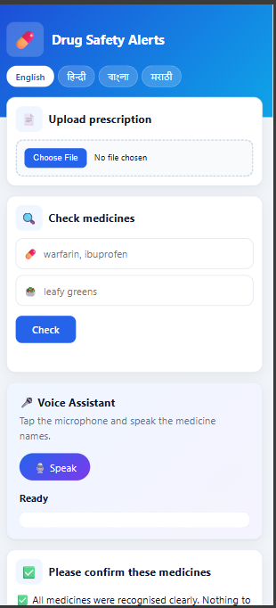
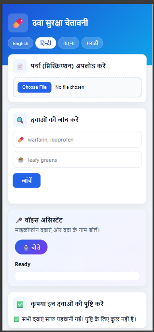
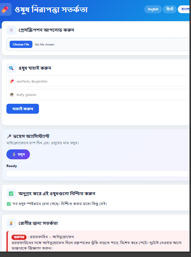
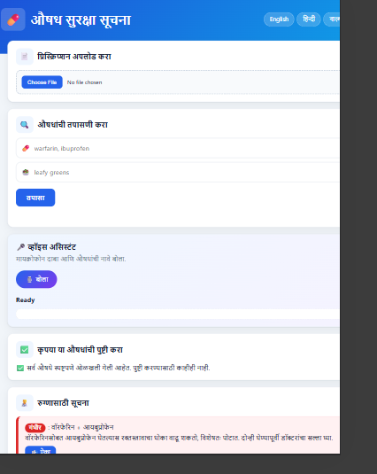
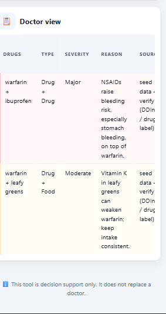

# Drug Safety Alerts: Frontend

A multilingual web app that shows drug and food interaction warnings from a prescription, for patients and for doctors.
Built for a 24-hour hackathon in a team of 3. I built the frontend (Member 3).
## Screenshots

## Features
- Patient alerts in English, Hindi, Bengali and Marathi, with voice
- Doctor view: interactions sorted by severity, with alternatives marked "for clinician review"
- Confirmation step: unclear medicine names are never guessed silently
- Voice assistant: speak medicine names in your language
- Disclaimer shown on every screen

## Tech
HTML, CSS, JavaScript (no framework), Web Speech API, `fetch()`.
Bengali and Marathi voice: a small FastAPI server (`tts_server.py`) using edge-tts, with a gTTS fallback and a local audio cache.

## Run it
1. Run `index.html` with the Live Server extension in VS Code.
2. In `app.js`, set `API_URL` to the interaction server's address.
3. For Bengali and Marathi voice:
   `pip install -r requirements.txt`, then `python -m uvicorn tts_server:app --port 8001`

Without an interaction server, the page starts with the sample data in `real_response.json`.

## A hard problem I solved
The Bengali and Marathi voice stopped working because the online voice service rejected my requests (error 403). I added a second voice service as a fallback and a cache, so sentences that were spoken once play again without internet.

## Limitations
- Interaction data is seed/test data and needs verification against drug labels.
- Hindi, Bengali and Marathi text needs review by native speakers before real use.
- Bengali and Marathi voice uses online services, so the sentence text is sent to them.
- Decision support only. This is not medical advice and does not replace a doctor or pharmacist.
